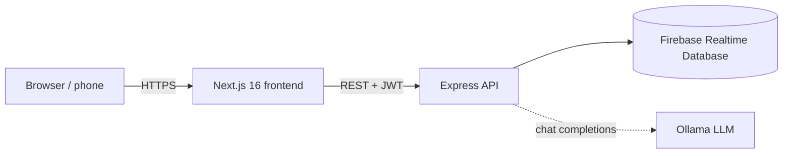

# CircuFi

**Digital rotating-savings circles (ajo / osusu / esusu / tontine) with a transparent ledger, trust scoring and an AI assistant.**

CircuFi replaces the notebook and the WhatsApp screenshots of a traditional savings circle with a shared, auditable record: who paid, when, how reliably, and whose turn it is to receive the pot. It does **not** move money — members pay each other as they always have (bank transfer, mobile money, cash) and log the payment in CircuFi, where the circle admin confirms it.


---

## Contents

- [How it works](#how-it-works)
- [Features](#features)
- [Architecture](#architecture)
- [Repository layout](#repository-layout)
- [Quick start](#quick-start)
- [Configuration](#configuration)
- [API overview](#api-overview)
- [Scoring model](#scoring-model)
- [Testing and quality](#testing-and-quality)
- [Deployment](#deployment)
- [Security notes](#security-notes)
- [Known limitations and roadmap](#known-limitations-and-roadmap)

## How it works

1. A user **signs up** with a phone number (Nigeria `+234` or Cameroon `+237`) and confirms it with a one-time code.
2. They **create a circle** (contribution amount, frequency, member limit) and receive an **invite code** such as `OSU-4X7K`. Others join with that code, or the admin adds them by phone number.
3. Members are placed in a **rotation order**. In every round one member is the *beneficiary* and all others pay the fixed contribution to them outside the app.
4. Each payer **logs the payment**. The admin **confirms** it. Confirmation records a reputation event (on time / late), updates the payer's trust score and refreshes the circle's health score.
5. When the round is complete the admin **advances the rotation**; after the last member a cycle is completed and the next one starts.
6. Members can ask the **AI assistant** questions about their circle (next payout, own payment status, trust score).

## Features

| Area | What you get |
|---|---|
| Accounts | Phone + OTP sign-up and login, JWT sessions, profile editing |
| Circles | Create, invite by code or phone, member limits, minimum trust score, remove members |
| Ledger | Contribution logging, admin confirmation, on-time / late detection, per-user and per-circle history |
| Rotation | Ordered beneficiaries, current / next payout, advance round, cycle counter |
| Reputation | Trust score (0–100), on-time rate, reputation event log, flags |
| Circle health | Health score, completion and on-time rates, trend, risk flags, recommendations |
| Notifications | Member joined, payment logged, payment confirmed |
| AI assistant | Context-aware chat per circle, running on a local LLM through [Ollama](https://ollama.com) |

## Architecture



- **Frontend** – Next.js App Router, React 19, Tailwind CSS 4, Zustand (persisted auth store), Axios.
- **Backend** – Express 4, TypeScript, Zod request validation, JWT auth, Firebase Admin SDK.
- **Data** – Firebase Realtime Database (`users`, `groups`, `contributions`, `reputationEvents`, `notifications`, `chatSessions`).
- **AI** – Ollama (default model `mistral`); optional, the rest of the app works without it.

## Repository layout

```
circufi/
├─ packages/
│  ├─ backend/            Express API  (@circufi/backend)
│  │  ├─ src/routes/      auth, users, groups, contributions, reputation, chat, notifications
│  │  ├─ src/services/    firebaseService, authService, reputationService, ollamaAIService
│  │  ├─ src/middleware/  JWT auth, error handling
│  │  └─ tests/           Jest + Supertest, in-memory database stand-in
│  ├─ frontend/           Next.js app  (@circufi/frontend)
│  │  ├─ app/             pages (landing, auth, dashboard, circles, payments, reputation, settings…)
│  │  ├─ components/      UI kit, layout, circle card
│  │  └─ lib/ stores/     API client, types, helpers, auth store
│  └─ shared/             shared TypeScript types and constants (@circufi/shared)
├─ docker-compose.yml     api + web (+ optional Ollama)
└─ package.json           npm workspaces and top-level scripts
```

## Quick start

### Prerequisites

- Node.js **20.9 or newer** and npm
- A Firebase project with **Realtime Database** enabled and a service-account key
- *(optional)* [Ollama](https://ollama.com) for the AI assistant

### 1. Install

```bash
git clone <repo-url> circufi && cd circufi
npm install
```

### 2. Configure

```bash
cp packages/backend/.env.example  packages/backend/.env      # fill in Firebase values
cp packages/frontend/.env.example packages/frontend/.env.local
```

Firebase: *Project settings → Service accounts → Generate new private key*, then copy `project_id`, `client_email` and `private_key` into `packages/backend/.env`, and set `FIREBASE_DATABASE_URL` to your Realtime Database URL.

In the Realtime Database **Rules** tab, deny all client access (the API uses the Admin SDK, which bypasses rules) and add the two indexes the API queries use:

```json
{
  "rules": {
    ".read": false,
    ".write": false,
    "users":  { ".indexOn": ["phoneNumber"] },
    "groups": { ".indexOn": ["inviteCode"] }
  }
}
```

### 3. Run

```bash
npm run dev            # API on :5000 and web on :3000
```

Open <http://localhost:3000>, choose **Create account**, enter a `+234…` or `+237…` number and a name. With `NODE_ENV=development` there is no SMS gateway: the code is printed in the API console and is always **`123456`**.

Optional AI assistant:

```bash
ollama serve &
ollama pull mistral
```

### Useful commands

| Command | Purpose |
|---|---|
| `npm run dev` | API + web with hot reload |
| `npm test` | Backend test suite (no Firebase needed) |
| `npm run typecheck` | Type-check shared, backend and frontend |
| `npm run build` | Production build of all packages |
| `npm run start:backend` / `start:frontend` | Run the production builds |

## Configuration

**Backend** (`packages/backend/.env`)

| Variable | Required | Description |
|---|---|---|
| `NODE_ENV` | yes | `development` (fixed OTP `123456`) or `production` |
| `PORT` | no | API port, default `5000` |
| `CORS_ORIGIN` | yes | Exact origin of the frontend, e.g. `https://app.example.com` |
| `FIREBASE_PROJECT_ID`, `FIREBASE_CLIENT_EMAIL`, `FIREBASE_PRIVATE_KEY`, `FIREBASE_DATABASE_URL` | yes | Firebase Admin credentials |
| `JWT_SECRET` | **yes in production** | Token signing secret; the server refuses to sign tokens without it in production |
| `JWT_EXPIRATION` | no | Default `7d` |
| `OLLAMA_API_URL`, `OLLAMA_MODEL`, `OLLAMA_TEMPERATURE`, `OLLAMA_TIMEOUT_MS` | no | AI assistant settings |

**Frontend** (`packages/frontend/.env.local`)

| Variable | Description |
|---|---|
| `NEXT_PUBLIC_API_URL` | API base **up to `/api`** (default `http://localhost:5000/api`). Inlined at build time. |

## API overview

Base URL `http://localhost:5000/api/v1`. All routes except `/auth/*`, `/chat/health` and `/health` need `Authorization: Bearer <token>`. Responses use the envelope `{ "success": true, "data": … }` or `{ "success": false, "error": { "code", "message", "statusCode" } }`.

| Resource | Endpoints |
|---|---|
| Auth | `POST /auth/register` · `POST /auth/verify` · `POST /auth/resend` |
| Users | `GET /users/:id` · `PUT /users/:id` (own profile only) |
| Circles | `POST /groups` · `GET /groups` · `GET /groups/:id` · `PUT /groups/:id` · `GET /groups/code/:code` · `POST /groups/:id/join` |
| Members | `GET /groups/:id/members` · `POST /groups/:id/members` (admin) · `DELETE /groups/:id/members/:userId` (admin) |
| Rotation & health | `GET /groups/:id/rotation` · `POST /groups/:id/rotation/advance` (admin) · `GET /groups/:id/health` |
| Contributions | `POST /contributions` · `GET /contributions/:groupId` · `GET /contributions/user/:userId` · `PUT /contributions/:id` · `POST /contributions/:id/verify` (admin) |
| Reputation | `GET /reputation/:userId` · `GET /reputation/:userId/events` |
| Notifications | `GET /notifications/:userId` · `PUT /notifications/:userId/mark-read` |
| AI chat | `POST /chat/message` · `GET /chat/sessions` · `GET /chat/sessions/:id` · `GET /chat/health` |
| Service | `GET /health` · `GET /api/version` |

Phone numbers must be in E.164 format (`+2348123456789`, `+237671234567`). Circle data is visible to its members only.

Example — create a circle:

```bash
curl -X POST http://localhost:5000/api/v1/groups \
  -H "Authorization: Bearer $TOKEN" -H "Content-Type: application/json" \
  -d '{"name":"Ikeja Market Women","contributionAmount":25000,"currency":"NGN","frequency":"monthly","maxMembers":8}'
```

## Scoring model

**Trust score** (per user, 0–100):

```
score = 50 + 0.3 × onTimeRate + 2 × min(confirmedPayments, 20) − 5 × flags      (clamped to 0…100)
```

**Circle health** = `0.6 × average member trust score + 0.4 × payment completion rate`.

Every confirmed payment also writes a **reputation event** to the user's audit log (on time `+5`, late `−3` and a flag (flags are de-duplicated by reason), missed `−10` and a flag, flagged `−5`, verified `+3`, dispute resolved `+2`). The impact values are recorded for transparency; the trust score itself is recomputed from the formula above. A payment is *on time* when it is made on or before the circle's due date.

## Testing and quality

```bash
npm test               # 42 tests: auth, circles, membership, rotation, contributions, reputation, notifications
npm run typecheck      # shared + backend + frontend, strict mode
```

The API tests run against an in-memory implementation of the database layer (`packages/backend/tests/helpers/inMemoryFirebase.ts`), so they need no credentials or network.

## Deployment

### Docker Compose (api + web)

```bash
cp packages/backend/.env.example packages/backend/.env     # set NODE_ENV=production values, JWT_SECRET, Firebase
docker compose up --build                                  # web :3000, api :5000
docker compose --profile ai up --build                     # also start Ollama
```

Set the public API URL for the browser at build time (`NEXT_PUBLIC_API_URL` build arg in `docker-compose.yml`) and `CORS_ORIGIN` on the API to the public URL of the frontend.

### Separate hosts

- **API** – any Node 20 host (Render, Railway, Fly.io, a VM): `npm ci && npm run build -w @circufi/shared -w @circufi/backend`, start with `node packages/backend/dist/index.js`, health check `GET /health`.
- **Web** – Vercel or any Node host: root directory `packages/frontend`, build command `npm run build`, env `NEXT_PUBLIC_API_URL=https://<api-host>/api`.

Production checklist: strong `JWT_SECRET`, `NODE_ENV=production`, HTTPS everywhere, exact `CORS_ORIGIN`, Firebase security rules that deny all client access (the API uses the Admin SDK), and a real SMS provider (see below).

## Security notes

- JWT bearer tokens; the secret is mandatory in production.
- All circle, member, contribution and profile reads require authentication and circle membership; payment history and notifications are readable by their owner only. A user's phone number and email are shown only to that user and to people who share a circle with them.
- Only the circle admin can confirm payments, add or remove members and advance the rotation. Members cannot confirm their own payments.
- Request bodies are validated with Zod; one-time codes are 6 digits from a cryptographic RNG, expire after 10 minutes and lock after 3 wrong attempts.

## Known limitations and roadmap

- **No SMS gateway yet.** Codes are printed to the server log outside production. Integrate a provider (Twilio, Africa's Talking, …) in `authService` before going live.
- **One-time codes are stored in memory**, so they do not survive a restart and do not work across several API instances. Move them to Redis or Firebase for multi-instance deployments.
- **No rate limiting** on the auth endpoints yet (add `express-rate-limit` or a gateway rule).
- **No money movement.** Payments are logged, not processed; there is no escrow.
- Circle currency is currently created as NGN in the UI; the API accepts any 3-letter ISO code.
- `packages/shared` is built but not yet consumed by the backend or frontend; adopt it for the API types or remove it.
- Notification and privacy preferences, account deletion and phone-number change are not implemented.
